<p align="center"></p>

# Vitals (MetaTrader 5 and MetaTrader 4)

A free, read-only account card for the chart: **equity, floating drawdown against today's worst and the worst recorded day,
margin, open positions with the risk at their stops, exposure per currency, results by period and account statistics**, on
one draggable, foldable card with three tabs. It never places, changes or closes an order. Source for both editions, a
Python reference of every number, and the tests that were used to check that the MT5 code, the MT4 code and the Python
reference agree.

**Website:** [allanninal.dev/mql5 (utilities)](https://www.allanninal.dev/mql5/#utilities) · [MT4 editions](https://www.allanninal.dev/mql5/#mt4) · [allanninal.dev](https://www.allanninal.dev)
· **Contact:** message me on [LinkedIn](https://www.linkedin.com/in/allanninal/).

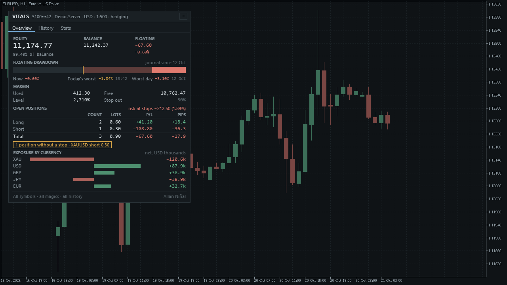

> It reports what the account did and where it stands. It does not judge whether a strategy will work. Nothing here is a
> profit claim (see [Honest limits](#honest-limits)).

## Get it on the MQL5 Market

All four listings are **coming soon**: the products are not uploaded yet. The links will be added here when they exist.

| Edition | Platform | Price | Link |
|---|---|---|---|
| Vitals | MT5 | free | coming soon on the MQL5 Market |
| Vitals MT4 | MT4 | free | coming soon on the MQL5 Market |
| Vitals Pro | MT5 | paid | coming soon on the MQL5 Market |
| Vitals Pro MT4 | MT4 | paid | coming soon on the MQL5 Market |

The Market builds will be the same code as the source in this repository. The Pro editions are a separate, paid product that
is **not** part of this repository (see [Free vs Pro](#free-vs-pro)).

## Contents

1. [What it is and who it is for](#what-it-is-and-who-it-is-for)
2. [Why it was built](#why-it-was-built)
3. [How it works](#how-it-works)
4. [How it was tested](#how-it-was-tested)
5. [Architecture](#architecture)
6. [Inputs, files, install and compile](#inputs-files-install-and-compile)
7. [Run the Python reference and the tests](#run-the-python-reference-and-the-tests)
8. [Honest limits](#honest-limits)
9. [Free vs Pro](#free-vs-pro)
10. [Licence](#licence)

## What it is and who it is for

**What:** one card on the chart, about 460 pixels wide at 100 % scale, redrawn once a second and only when something
changed. It scales with the screen's DPI and with an input, follows the chart's colours (dark or light, or fixed), and keeps
its place, fold state and tab per chart. Three tabs:

- **Overview:** equity, balance and floating result; a **floating drawdown bar** (now, today's worst with the time it was
  reached, the worst recorded day); margin used, free, level and stop-out; long, short and total open positions (count, lots,
  profit, pips); the **risk at the stops** in money and percent, and a note when positions have no stop; **exposure by
  currency**, net, in thousands of the account currency.
- **History:** today, the four trading days before it that had trades, this week (from Monday), this month and this year:
  trades, wins/losses, net, gain in percent of the balance at the start of the period, the worst day's floating drawdown, lots;
  plus the average gain per trading day and per month.
- **Stats:** win rate, profit factor, expectancy, average win and loss, reward/risk, maximum and relative drawdown of the
  closed-trade balance curve, a 60-day Sharpe ratio, best and worst day, and costs (commission, swap, fees).

Filters (symbol, magic number, comment, start date) apply to trades, positions, risk and exposure; the account figures are never
filtered.

**For:** traders who want the state of the whole account in one place, especially the **floating drawdown of each day**, which a
history report does not contain. Also for developers: the engine is a small, tested core you can read and reuse.

**Not for:** limits, alarms, per-EA tables or trade management. It only displays.

| | |
|---|---|
| 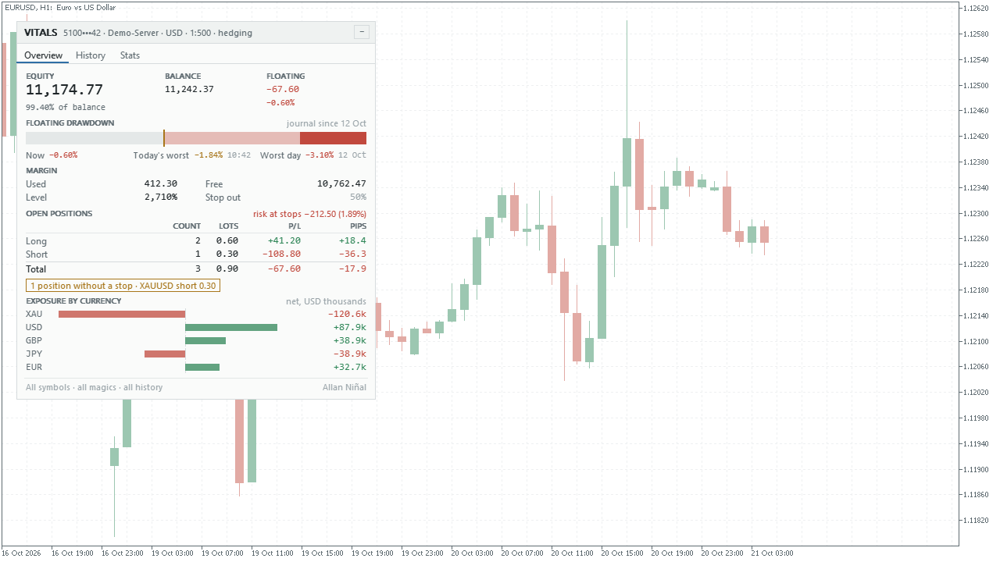 | 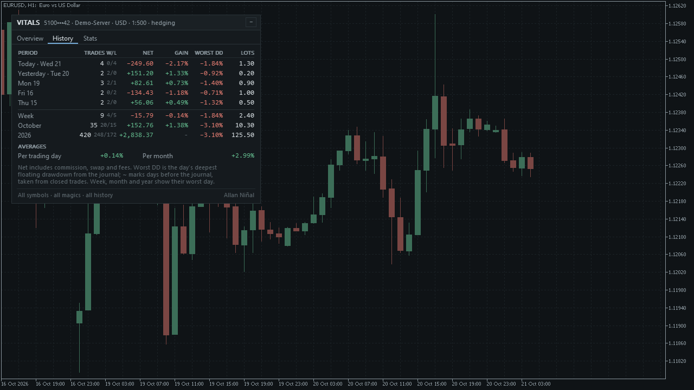 |
| 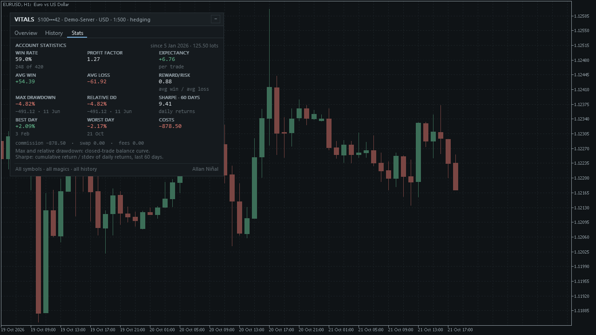 | 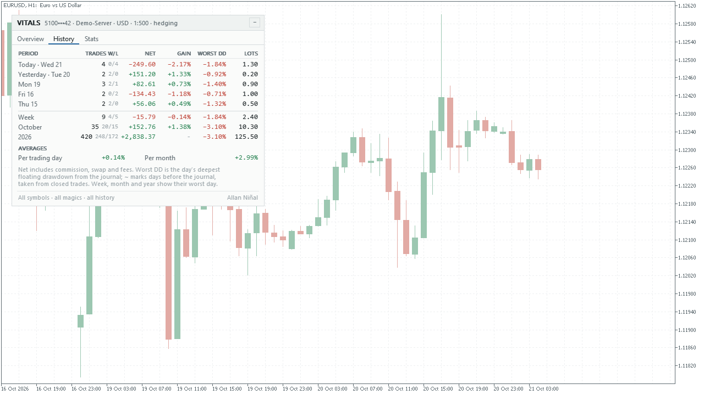 |

Image notes: the screenshots were taken from a test build that feeds the card made-up account data (a demo account, 420
trades from January to October 2026), drawn over a normal price chart. The account login on the card is masked and made up. They
show what the card looks like, not trading results. The MT4 edition looks the same; its screenshots are in
[`docs/images/mt4/`](docs/images/mt4).

## Why it was built

- **The number a history report lacks.** A closed-trade report says what a position earned, not how far the account sank
  below its balance while it was open. MetaTrader keeps no past floating equity, so the card **records** the lowest floating
  result of every server day while it runs, in a small file, and shows it. That is its signature, and its limit: it can only
  start the day it is attached (see [Honest limits](#honest-limits)).
- **A native, readable card.** Our October 2026 scan of the MQL5 Market found plenty of free account dashboards, several
  with a fixed pixel size that does not follow a high-DPI screen, and at least one that states that its equity reconstruction is
  approximate. This card scales, and says plainly which figures are recorded and which are estimated (a `~` in the table).
- **Honest scale of demand.** The same scan found that account panels collect few reviews (almost none above 30), so this is a
  free tool with a clear method, not a claim of mass demand.
- **Provable numbers.** Every statistic follows a written rule and is compared with an independent Python version, see
  [How it was tested](#how-it-was-tested).

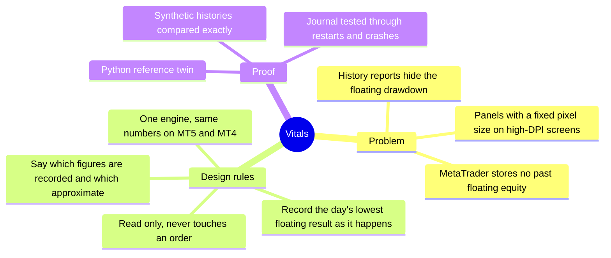

## How it works

### The model: deals, positions, trades

The engine ([`VtCore.mqh`](mql5/Include/Vitals/VtCore.mqh)) is plain computation on a list of deals. It makes no terminal call,
so the same code can be run on synthetic deals and compared with Python.

For each deal, in time order (MT4: orders turned into deals, see [below](#mt4-orders-become-deals)):

1. A **credit** deal is ignored. Any other deal adds `profit + swap + commission + fee` to a running sum, with its time: that
   sum is how the balance before any moment is rebuilt.
2. A **balance** deal (deposit, withdrawal, charge, correction) is cash flow: it counts in the rebuilt balance, never as a trade.
3. A buy or sell deal belongs to a **position** (its position id). An opening deal creates it or adds volume; every deal adds its
   `profit + swap + commission + fee` to the position's net. If the opening deal is missing from the history, the first deal seen
   opens the position.
4. A position becomes a **trade** when its closed volume reaches its opened volume (`OUT` or `OUT_BY` deals). A reversing deal
   (`INOUT`, netting accounts) closes the trade and opens the next one with the volume beyond. A trade belongs to the **day of
   its closing deal** and counts only if it passes the filters and was closed on or after the start date.

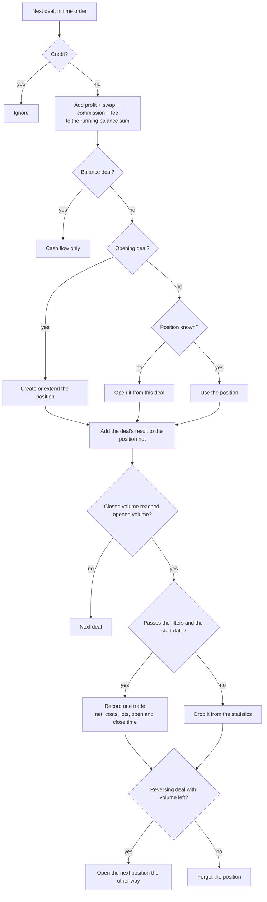

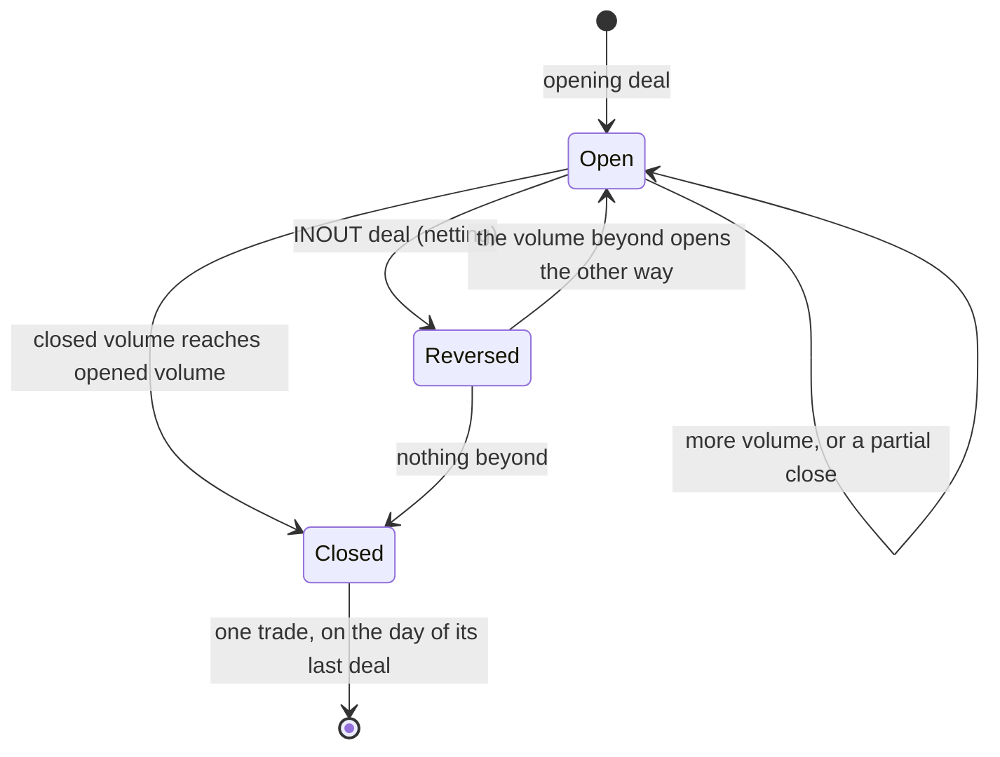

### The floating-drawdown journal

MetaTrader keeps no past floating equity, so [`VtJournal.mqh`](mql5/Include/Vitals/VtJournal.mqh) records it: on every
timer tick and every tick of the chart it takes `equity - credit - balance`, keeps the lowest value of each server day
(never above 0) and its percent of the balance at that instant. One line per day, `day,money,percent`, goes to
`Files/Vitals/FDD_<login>.csv`. The file is rewritten when the day's low got deeper and the last write is 10 seconds old, and when
the card is removed. Every write first merges with what the file already holds (another chart of the same account), keeping the
deeper low per day. A crash loses at most the last 10 seconds of depth, never a day.

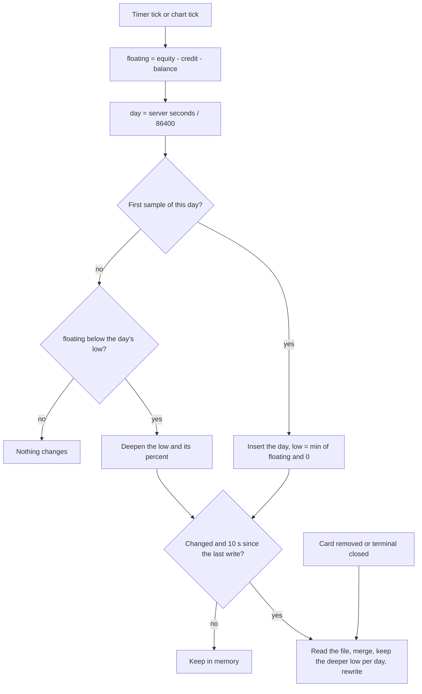

### Periods, gain and worst drawdown

- **Balance before a period** = the current balance minus every balance-affecting deal at or after the period's first moment
  (cash flow included). **Gain %** of a row is its net divided by that balance.
- **Rows:** today; up to four earlier days that had trades; the week (back to Monday); the month; the year. Their days are
  server calendar days.
- **Worst DD** of a day is the journal's value when the journal has that day; otherwise the deepest peak-to-trough of that
  day's closed-trade curve, shown with `~` and dimmed. A week, month or year row shows its worst day. Days with neither show `-`.
- **Averages:** the mean daily return over days with trades (`100 * day net / balance before the day`), and the mean monthly return
  over months with trades (month net / balance before the month's first day).

### Statistics

Let `W` be the winning trades (net above 0), `L` the losing ones (net below 0), `GP` the sum of the wins, `GL` the sum of the
losses as a positive number, `N` the trades.

| Figure | Rule |
|---|---|
| Win rate | `100 * W / N` |
| Profit factor | `GP / GL` (shown as "no losses" when `GL = 0` and `GP > 0`) |
| Expectancy | `(GP - GL) / N` per trade |
| Average win, average loss | `GP / W`, `-GL / L` |
| Reward/risk | `(GP / W) / (GL / L)` |
| Maximum drawdown | on the closed-trade balance curve, starting from the balance before the first trade opened: the largest `peak - curve`, with its percent of that peak and its date |
| Relative drawdown | the largest `100 * (peak - curve) / peak` over the same curve, with its date |
| Sharpe, 60 days | over the last 60 calendar days (today and the 59 before): `sum(daily returns) / stdev(daily returns)`, sample standard deviation, needs 2 or more trading days with a return and a non-zero deviation |
| Best day, worst day | the highest and lowest daily return in percent, with their dates |
| Costs | commission + swap + fees of the counted trades |

The formulas follow the definitions that prop-firm statistics pages publish (the Sharpe line is the one such a page documents: cumulative
return over the standard deviation of daily returns). This project is not affiliated with any firm.

### Open positions, risk and exposure

- **P/L** of a position is profit plus swap. **Pips** are `(current - open) / point / m`, with `m` points per pip chosen from the
  symbol's digits and kind (5-digit FX and 1-digit quotes: 10; 3-digit yen or silver and 2-digit gold: 10; one more digit: 100).
  Short positions are negated.
- **Risk at the stops** is the loss at the stop-loss price in account money: MT5 asks the terminal for the profit calculation at
  that price (`OrderCalcProfit`, which only calculates); MT4 uses `distance / tick size * tick value * lots`, with a documented
  fallback when the tester gives a tick value of 0. Positions without a stop are counted and the first is named.
- **Exposure by currency:** each position contributes `+/- notional` in account money (volume x contract size x price x the
  profit currency's rate to the account currency, from a cross symbol, else from the terminal's tick value): long adds the base
  currency and subtracts the profit currency. When base and profit currency are the same (an index CFD) the symbol is its own
  "currency". The six largest nets are shown.

### MT4: orders become deals

MetaTrader 4 keeps orders, not deals. [`VtLive.mqh`](mql4/Include/Vitals/VtLive.mqh) turns them into the same deal list the engine reads on MT5:
each order becomes an opening deal at its open time and, once closed, a closing deal at its close time carrying profit, swap and
commission. A partial close leaves an order for the closed part and opens a new one commented `from #<ticket>`: the chain is one
position, keyed by its first ticket. Balance records are cash flow, credit records are credit. The deals are ordered by time,
then cash before opening before closing, then reading order. The list is rebuilt whenever the history or the open orders change.

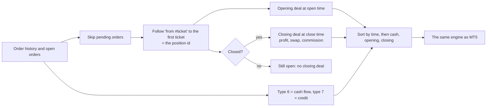

### One refresh

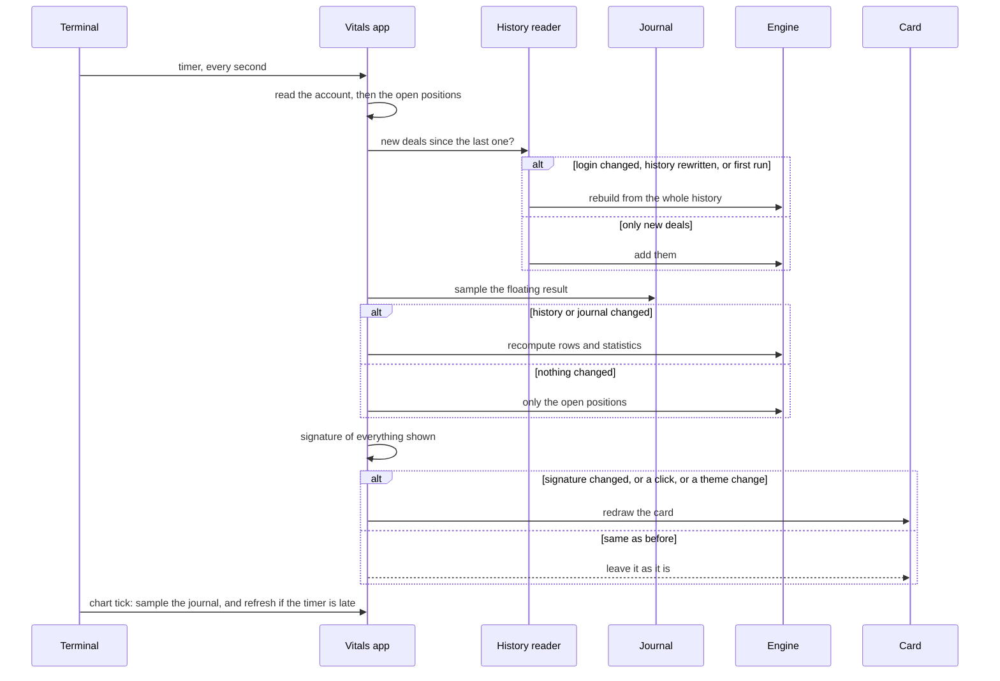

### The card

The card is one `CCanvas` bitmap label. Drag it by the header, fold it to the header with the button, click a tab. Chart
scrolling is paused while the mouse button is down on the card. It stays inside the chart, and its position, fold state and tab are kept
per chart in terminal global variables. In the Strategy Tester the card is not drawn; the engine still runs.

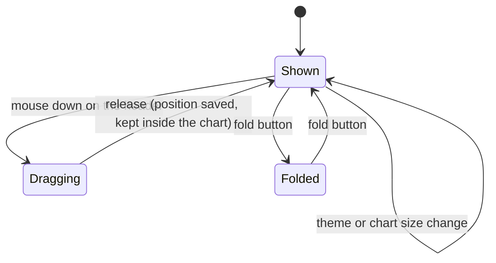

## How it was tested

Every number in sections 1 to 3 was produced by a run of this repository's code on 21 October 2026, and its output is in [`tests/results/`](tests/results). Section 4 is clearly marked as a different set of runs.

**1. The engine against Python, on synthetic histories.** [`tests/reference.py`](tests/reference.py) follows the rules operation
by operation. [`tests/check_core.py`](tests/check_core.py) writes eleven seeded synthetic cases (hedging and netting positions,
partial closes, reversals, cash flow and credit, commission, swap and fees, the symbol, magic, comment and start-date filters, "now" on a
Monday, on the first of a month, on 1 January and on a Sunday, an empty history, a 3,000-position history), plus open
positions and a floating-drawdown journal. A dump tool runs the MetaTrader engine on them
([`tests/mql5/Scripts/VitalsDump.mq5`](tests/mql5/Scripts) as a script, [`tests/mql4/Experts/VitalsDump4.mq4`](tests/mql4/Experts) in the MT4
Strategy Tester) and writes every number the card shows; the checker compares counts exactly and money and percentages within 1e-9
relative.

| Case | Deals | Trades | Values compared | MT5 | MT4 |
|---|---|---|---|---|---|
| hedging, plain | 701 | 276 | 2,160 | pass | pass |
| netting reversals | 1,881 | 761 | 4,257 | pass | pass |
| filter by symbol | 1,189 | 93 | 874 | pass | pass |
| filter by magic and comment | 2,048 | 31 | 431 | pass | pass |
| now = Monday 00:00:05 | 1,394 | 562 | 3,598 | pass | pass |
| now = 1 November | 1,407 | 569 | 3,573 | pass | pass |
| now = 1 January | 1,633 | 664 | 4,045 | pass | pass |
| start-date filter | 1,659 | 315 | 2,027 | pass | pass |
| empty history | 0 | 0 | 110 | pass | pass |
| Sunday, 3,000 positions, netting | 6,939 | 2,813 | 9,139 | pass | pass |
| no cash flow | 931 | 378 | 2,743 | pass | pass |
| **Total** | **19,782** | **6,462** | **32,957** | **ALL PASS, 0 mismatches** | **ALL PASS, 0 mismatches** |

Sources: [`tests/results/parity-mt5.txt`](tests/results/parity-mt5.txt), [`tests/results/parity-mt4.txt`](tests/results/parity-mt4.txt). Compile results: [`tests/results/compile.txt`](tests/results/compile.txt).

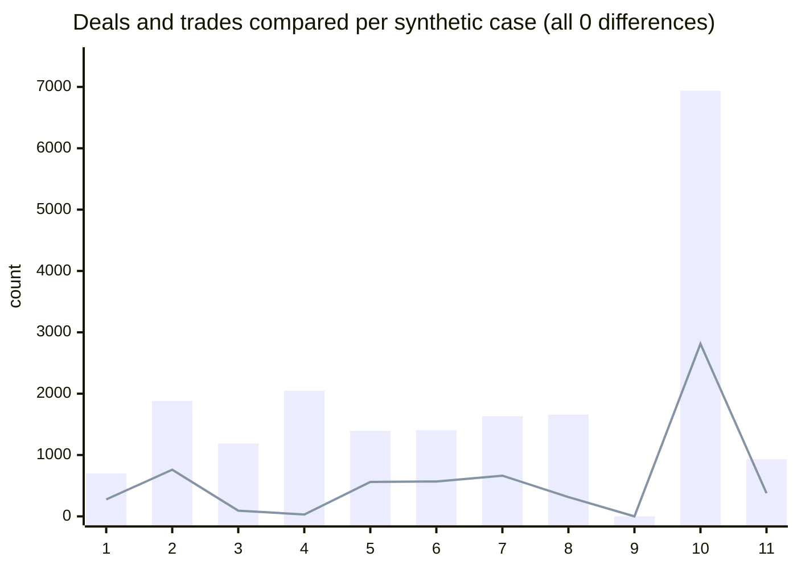

Bars: deals. Line: trades. Cases in the table's order. The eleven cases are the same for both platforms; the values are the numbers the card shows (rows,
statistics, per-day figures, open positions, exposure).

**2. The journal, through restarts and crashes.** A scripted equity path crosses midnight, restarts cleanly and by crash (no final
write), jumps three days, deposits, changes the balance, has a flat day, and has another chart writing a deeper low into the file. The
journal file after each restart, and the final memory, are compared line by line with a Python model of the same rules.

Result on both platforms: 990 samples, 6 restarts, 6 days, 43 lines compared, **0 mismatches** (same two result files).

**3. The pip table.** 19 symbol and digit pairs (FX, yen, gold, silver, indices, crypto, suffixed names) are compared with the Python
function.

Result on both platforms: 19 of 19 equal (same two result files).

**4. Checked on the full build before the free/paid split.** These ran on the build the free and paid editions were cut from, with
harnesses that use internal test builds and are **not** in this repository, so they cannot be repeated from here:

| Check | Result |
|---|---|
| Engine parity on 11 synthetic cases (MT5 dump) | 19,799 deals, 75,617 values, 0 mismatches |
| Engine against tester account histories, MT5 (4 runs plus snapshots) | 21,626 deals, 82,846 values, 0 mismatches |
| Engine against tester order histories, MT4 (4 runs plus snapshots) | 29,590 deals, 107,958 values, 0 mismatches |
| Validator-style runs ($100 and $100,000 accounts, 5 symbols and timeframes, every tick on MT4 EURUSD H1 and XAUUSD M5) | 20 runs per platform, 0 error lines |
| History loader | MT5: 24.9 ms for 10,294 deals, 1.65 s for 69,547 deals; MT4: 16 to 156 ms for 1.5 to 6.7 thousand deals |
| Card refresh with a full redraw | MT5 1.0 to 1.8 ms, MT4 about 12 ms |
| Empty history | the card draws (22 screenshots per platform) |

(The value counts include a few figures that exist only in the paid edition, so they are not the same as this repository's own run above.)

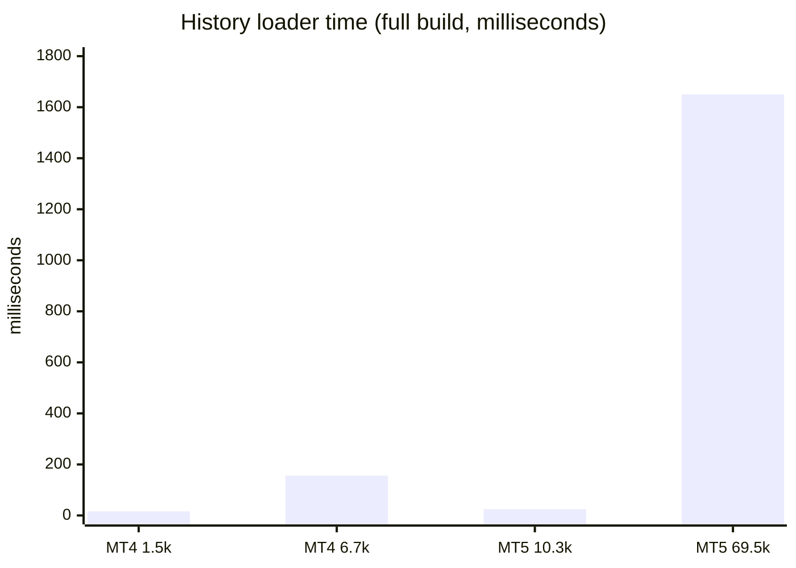

(The number after MT4 or MT5 is the deals in the history; the MT4 times are the range quoted above, shortest and longest.)

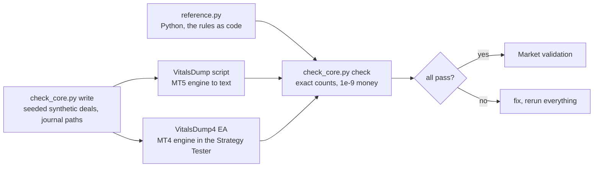

**What the tests do not cover.** The card's drawing and the mouse handling are not part of this repository's tests (they were checked on the
full build, with screenshots and scripted mouse events). The history reader that calls the terminal (`HistoryDeal*`, `Order*`) is
covered only through the full-build runs above. Netting accounts were tested on synthetic histories only; the tester account is a
hedging account. Nothing here is a test on a live account.

## Architecture

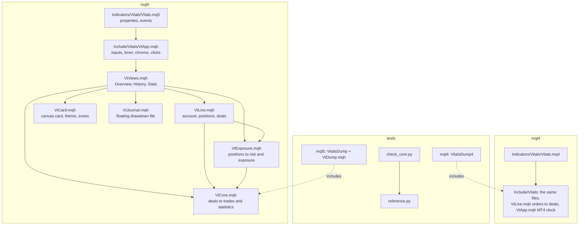

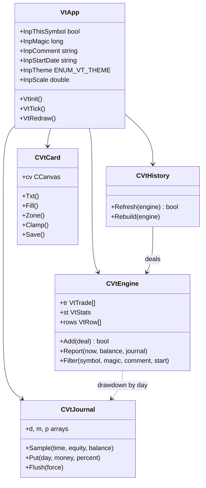

The indicator has no buffers and no `iCustom` interface (MT4 keeps one hidden buffer so that an instance created from another
program stays alive).

## Inputs, files, install and compile

| Input | Default | Meaning |
|---|---|---|
| Only the chart's symbol | false | Filter trades, positions, risk and exposure to this chart's symbol |
| Only this magic number | -1 | -1 = all |
| Only comments containing | empty | Case-insensitive text |
| Ignore trades closed before | empty | `YYYY.MM.DD`, server date |
| Theme | Auto | Auto follows the chart background; Dark; Light |
| UI scale | 1.0 | Multiplies the screen's DPI scale |

**Files and settings it writes.** `MQL5/Files/Vitals/FDD_<login>.csv` (MT4: `MQL4/Files/Vitals/FDD_<login>.csv`): the journal, one line per
day. Terminal global variables `VITALS_<chart id>_x`, `_y`, `_fold`, `_tab`: the card's place, fold state and tab for that chart.
Nothing else, and no network access.

**Install from source.** MT5: copy `mql5/Indicators/Vitals/` into `<terminal data folder>/MQL5/Indicators/` and `mql5/Include/Vitals/`
into `<data folder>/MQL5/Include/`, open `Vitals.mq5` in MetaEditor and press Compile (F7). MT4: copy `mql4/Indicators/Vitals/` and
`mql4/Include/Vitals/` into the matching folders under `<data folder>/MQL4/`, open `Vitals.mq4` and compile. The source files need a
UTF-8 byte-order mark (they have one). Both editions compile with 0 errors and 0 warnings (checked with the MetaEditor of a MetaTrader 5 and a MetaTrader 4
build on a Windows machine; the compiled files are not in the repository).

## Run the Python reference and the tests

The reference needs only Python 3.

```python
import sys; sys.path.insert(0, "tests")
from reference import Engine, synth_case
deals, now, balance, journal, positions = synth_case(seed=1)   # seeded random history, deals in time order
e = Engine()                                                    # filters: symbol, magic, comment, start
for d in deals:
    e.add(d)
card = e.report(now, balance, journal)                          # flat dict of every number the card shows
card.update(e.positions(positions, balance))
print(card["st.winrate"], card["row.0.net"])
```

To repeat the engine check: `python3 tests/check_core.py write <dir>`, copy `<dir>/*.csv` to the terminal's `Files/vttest/`
(MT5: the common files folder; MT4: the Strategy Tester's `files` folder), compile and run `tests/mql5/Scripts/VitalsDump.mq5`
(MT5, once with `InpMode=0` and once with `InpMode=1`) or run `tests/mql4/Experts/VitalsDump4.mq4` in the Strategy Tester (MT4,
also once per mode), copy the `out_*.txt` and `journal_out.txt` files it wrote back into `<dir>`, and run
`python3 tests/check_core.py check <dir>`. The test tool includes `tests/mql5/Include/VitalsCheck/VtDump.mqh`: copy it to your
`Include/VitalsCheck/` folder first.

## Honest limits

- **The journal starts when you attach the card.** MetaTrader does not store past floating equity. Before that, the History tab falls
  back to the drawdown of the closed-trade curve, marked `~` and dimmed. The journal is also only as complete as the time the terminal was
  running with the card on the chart: a day the terminal was off has no recorded low.
- **Drawdown figures are of two kinds.** The floating drawdown is recorded from equity; the maximum and relative drawdown on the Stats tab
  come from the closed-trade balance curve and miss what happened inside open trades.
- **It reports history; it does not predict.** No profit or accuracy claim is made, and a handful of trades proves little.
- **Server time.** Days, weeks and months follow the server's calendar. MT4 has no trade-server clock and uses the time of the last tick.
- **History must be available.** The card counts what the terminal's account history holds; if you cut the history range in the terminal,
  the numbers change. Very large histories take longer to load the first time.
- **MT4 books the commission at the close**, and its history is orders, not deals: the server's own comment notes (`[sl]`, `[tp]`, `from #...`) are not treated as an EA's comment, and the order-to-deal conversion was
  tested only on the tester's account (in the full-build runs) and not on a live one.
- **Exposure and risk need conversion rates.** If no cross symbol exists for a profit currency, the terminal's own tick value is used, and
  symbols that give neither show 0.
- **Not a limit guard.** It shows today's floating drawdown but does not stop trading or warn at a level; that is not in this edition.
- **Scope of the tests.** Synthetic histories and the full-build runs listed above, not a live account. Netting was not tested on a real
  netting account.

## Free vs Pro

| | Free: Vitals | Paid: Vitals Pro |
|---|---|---|
| Platforms | MT5 and MT4, coming soon on the MQL5 Market | MT5 and MT4, coming soon on the MQL5 Market |
| Price | free | paid (see the Market page when it is live) |
| Tabs | Overview, History, Stats | those, plus more tabs and views and alerts and exports, as described on its Market listing |
| Source | this repository | not published |

No need to buy the paid product to use the free one: the free card is complete on its own.
Website: [allanninal.dev/mql5](https://www.allanninal.dev/mql5/#utilities) ([MT4](https://www.allanninal.dev/mql5/#mt4)).

## Licence

Everything is © 2026 Allan Niñal under the
[PolyForm Noncommercial License 1.0.0](LICENSES/PolyForm-Noncommercial-1.0.0.md): source-available, free for personal and other
noncommercial use, not for commercial use. Each source file has an `SPDX-License-Identifier` line; the text is in
[`LICENSE`](LICENSE). The licence applies to this source, not to anything you build or trade with the indicator. Trading involves
risk; the software is provided as is.

---

**Website:** [allanninal.dev/mql5](https://www.allanninal.dev/mql5/#utilities) · [MT4](https://www.allanninal.dev/mql5/#mt4) · [allanninal.dev](https://www.allanninal.dev)
· Questions: message me on [LinkedIn](https://www.linkedin.com/in/allanninal/).
